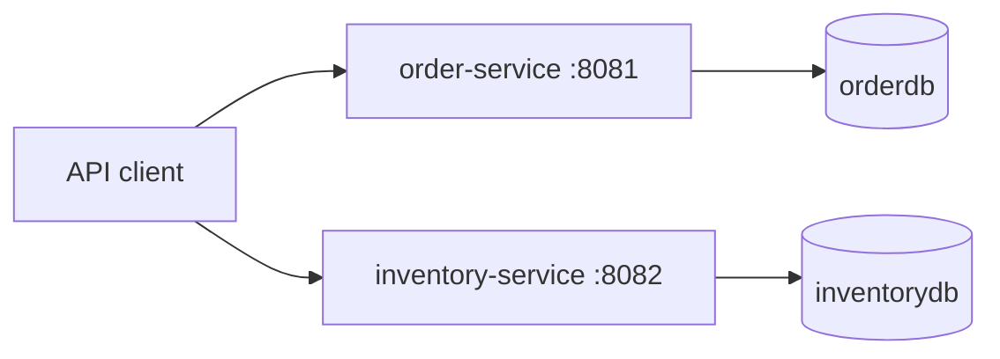
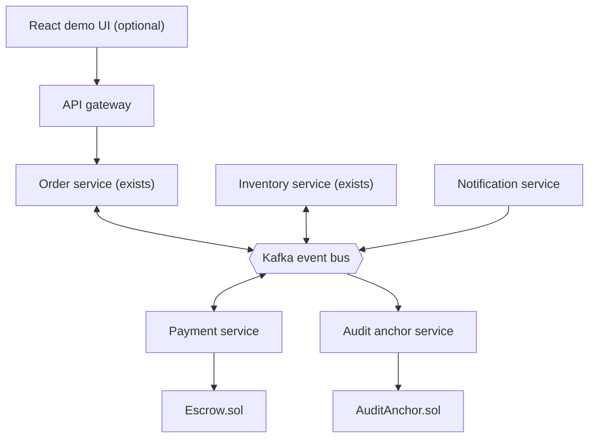

# Architecture

## Status at a glance

| Area | Status |
|---|---|
| Order service (REST + PostgreSQL) | Implemented (Phase 1) |
| Inventory service (REST + PostgreSQL) | Implemented (Phase 1) |
| Kafka broker, Redis | Configured in Docker Compose (they start only when you run `docker compose up`); **not used by any application code yet** |
| Service-to-service communication | Not implemented |
| Outbox, saga, idempotency keys | Planned (Phases 2-3) |
| Payment service, smart contracts | Planned (Phases 4-5) |
| Audit/anchor service | Planned (Phase 6) |
| API gateway, notification service | Planned (Phase 7) |

Stack in use: Java 21, Spring Boot 4.1.2, Spring Data JPA (Hibernate), Flyway, PostgreSQL 16,
springdoc-openapi 3.2.0, Maven multi-module. Tests: JUnit 5, Mockito, MockMvc, Testcontainers.

## Implemented now (Phase 1)

- Each service owns its own database (separate PostgreSQL databases on one local server).
- The two services do not call each other and share no data.
- `services/common` holds only a shared error response type.

## Planned target architecture

Everything in this diagram except the two services at the top is **planned, not built**.

## Design intentions (planned)

- Database per service. No shared tables.
- Reliable events through the transactional outbox pattern; consumers record processed event IDs.
- Orchestrated saga in the Order service with compensation. See `saga-flow.md`.
- Idempotency keys on order creation.
- Blockchain is a settlement and audit layer, not the system of record: PostgreSQL and Kafka carry
  the load, and only escrow state and batched audit roots go on-chain. Test networks only.

## Known Phase 1 limitations

- `unitPrice` on an order is client-supplied and not checked against inventory data.
- Creating an order does not check or reserve stock; orders remain `PENDING`.
- No authentication or authorization.
